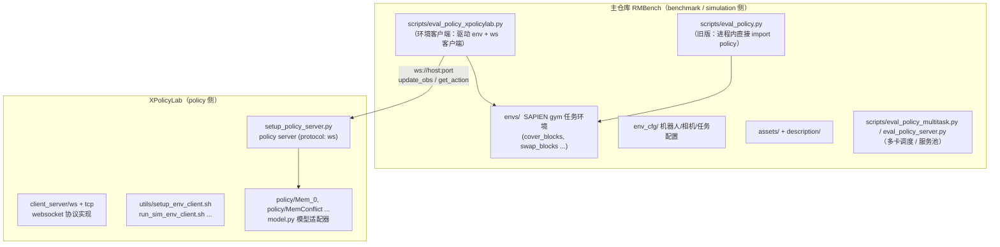

# RMBench 项目结构分析

## 1. 总体架构：两套“评测通道”并存

你的记忆基本正确——**通过 XPolicyLab 走的那条路径确实是 websocket 数据交换**。但 repo 里其实同时存在两条评测路径，一条是 websocket 客户端/服务器分离的，一条是进程内直接 import 的。

## 2. XPolicyLab 内部是否有一套完整的评测系统？

**有“策略服务 + 通用客户端脚手架 + RoboDojo 评测脚本”，但没有 RMBench 的任务仿真。**

XPolicyLab 自己包含的东西：

| 组成部分           | 位置                                                                                                                             | 作用                                                  |
| ------------------ | -------------------------------------------------------------------------------------------------------------------------------- | ----------------------------------------------------- |
| 策略服务器         | `setup_policy_server.py`                                                                                                         | 加载 `Model`，起 websocket（默认）/ tcp（legacy）服务 |
| 协议实现           | `client_server/ws/`、`client_server/tcp/`                                                                                        | msgpack 序列化、重连/重试/keepalive                   |
| 通用环境客户端脚本 | `utils/setup_env_client.sh`、`run_sim_env_client.sh`、`run_debug_env_client.sh`、`run_real_env_client.sh`、`debug_env_client.py` | 根据 `EVAL_ENV_TYPE` 选择 debug/sim/real 三种客户端   |
| RoboDojo 仿真评测  | `scripts/RoboDojo/`、`run_robodojo_sim_eval.sh`                                                                                  | 只服务 RoboDojo 基准，与 RMBench 无关                 |
| 策略适配器 zoo     | `policy/<63个策略>/`                                                                                                             | 每个适配器含 `model.py`、`deploy.yml`、`eval.sh` 等   |

但 XPolicyLab **刻意是 benchmark-agnostic 的**（README 原话：_"any benchmark, simulator, or real-robot setup can plug in as an environment client"_）。它没有任何 RMBench 的 `envs` 任务定义、`assets` 物体、`env_cfg` 配置。所以它没有“RMBench 的完整评测系统”。

## 3. 主仓库里的 “simulation” 是什么作用？

主仓库 = **benchmark 本体（仿真 + 环境客户端）**，具体是：

- **`envs`**：基于 SAPIEN 的 gym 环境（`_base_task.py` 里 `Base_Task(gym.Env)`），每个任务一个文件（`cover_blocks.py`、`swap_blocks.py`…），提供 `get_obs()` / `take_action()` / `setup_demo()` / `check_success()`。
- **`env_cfg`**：机器人本体配置（`aloha_agilex.yml`、`arx_x5.yml`、`franka.yml`）、相机配置、任务配置（`demo_clean` 等）、评测调度配置（`eval/all_tasks.yml`）。
- **`curobo`**：CuRobo 运动规划（另一个 submodule）。
- **`assets` + `description`**：物体模型与任务指令生成。
- **`eval_policy_xpolicylab.py`**：这是走 XPolicyLab 时的**环境客户端**。它干的事是：
  1. 建 `WsModelClient`（`from client_server.ws import WsModelClient`）
  2. 驱动 SAPIEN env，把 RoboTwin 观测转换成 XPolicyLab 格式（`robotwin_obs_to_xpolicylab`）
  3. 通过 websocket 调 `update_obs` / `get_action`
  4. 把返回的 action 转回 RoboTwin 格式（`xpolicylab_action_to_robotwin`）并 `take_action`
- **`eval_policy.py`**：旧版、进程内路径（不经过 websocket，直接 import `policy.<Name>.get_model`）。
- **`eval_policy_multitask.py` / `eval_policy_server.py`**：多 GPU 任务调度器和服务池启动器。

也就是说：**websocket 的“客户端”这一半实际上不在 XPolicyLab 里，而在主仓库的 `eval_policy_xpolicylab.py`**。XPolicyLab 只提供“服务器”那一半 + 通用的客户端启动脚本。

## 4. 当前耦合点（拆分要解决的地方）

两个方向都有耦合，但主要是**路径假设**，不是逻辑耦合：

**主仓库 → XPolicyLab：**

- `eval_policy_xpolicylab.py`：`from client_server.ws import WsModelClient`，靠 `add_xpolicylab_paths()` 把 `XPolicyLab` 塞进 `sys.path`；默认根目录写死 `ROBOTWIN_ROOT / "XPolicyLab"`。
- `eval_policy_multitask.py` / `eval_policy_server.py`：硬编码 `ROBOTWIN_ROOT / "XPolicyLab" / "policy" / ...`。
- `_install.sh`、`update_xpolicylab.sh`：submodule 管理。
- `pyproject.toml` 已声明 `xpolicylab` 依赖（说明作者本来就打算当 pip 包用）。

**XPolicyLab → 主仓库：**

- `utils/setup_env_client.sh` 里 `BENCH_ROOT = XPL_ROOT/..`，即**假设 XPolicyLab 一定被挂载在 benchmark 仓库内部**。
- `run_sim_env_client.sh` 最终执行 `${root_dir}/scripts/eval_policy.sh`（调主仓库的客户端）。
- `policy/MemConflict`、`policy/Mem_0` 的 `setup_eval_policy_server.sh` 用 `BENCH_ROOT`（= `RMBench`）去解析 checkpoint/norm_stats 路径。

## 5. 拆分是否可行？是否推荐？

**可行，而且推荐**——但建议当成一次有计划的架构重构，而不是“删掉 submodule 就完事”。理由：

1. **架构上本来就已经解耦了**。策略服务器和环境客户端之间只靠 websocket + msgpack 协议通信，边界清晰。这正是 XPolicyLab 的设计目标（"mount XPolicyLab into benchmark or simulator workspaces without coupling"）。
2. **XPolicyLab 已经支持 pip 安装**（`pyproject.toml` 里 `pip install -e .`，打包 `client_server*` 和 `utils*`，排除 `policy*`）。主仓库 `pyproject.toml` 也已声明 `xpolicylab` 依赖。

建议的拆分方式：

| 步骤              | 具体改动                                                                                                                                                                                |
| ----------------- | --------------------------------------------------------------------------------------------------------------------------------------------------------------------------------------- |
| 1. 去 submodule   | 删除 `.gitmodules` 里的 XPolicyLab 条目，改为版本 pin 的 pip 依赖（`xpolicylab==x.y.z`，或指向某个 tag/commit）                                                                         |
| 2. 去掉路径注入   | 删除 `eval_policy_xpolicylab.py` 里的 `add_xpolicylab_paths` 和 `DEFAULT_XPOLICYLAB_ROOT`，直接 `from client_server.ws import WsModelClient`（pip 安装后 `client_server` 顶层包可导入） |
| 3. 解耦路径假设   | 把 `BENCH_ROOT = XPL_ROOT/..` 改成显式传参/环境变量（如 `XPOLICYLAB_BENCH_ROOT` 或 `BENCH_ROOT`）；`run_sim_env_client.sh` 本来就有 `root_dir` 参数，只需由调用方显式提供               |
| 4. 调度器定位脚本 | `eval_policy_multitask.py` / `eval_policy_server.py` 里 `eval.sh`、`setup_eval_*.sh` 的路径改用环境变量或安装路径定位，而不是 `ROBOTWIN_ROOT/"XPolicyLab"`                              |
| 5. 策略适配器归属 | `MemConflict`/`Mem_0` 属于策略侧，留在 XPolicyLab（或挪到独立策略仓库）；checkpoint/norm_stats 路径本就通过 `--overrides` 显式传入，不依赖物理位置                                      |

**需要注意的两点：**

- XPolicyLab 的 `policy/` 目录（63 个策略）**不在 pip 打包范围内**。如果主仓库还要跑这些适配器，需要保留一个 XPolicyLab 的 checkout（可以只是普通 clone + 环境变量指向，不一定是 submodule），或者只把 `client_server` + `utils` 装成包、策略适配器单独管理。
- 当前 submodule 指向的是个人 fork（`https://github.com/horserr/XPolicyLab.git`）。如果转成 pip 依赖，建议 pin 到上游 release tag 或你们 fork 的稳定 commit，避免漂移。

**结论**：XPolicyLab 有完整的“策略服务 + 通用客户端协议 + 自己的 RoboDojo 评测”，但 RMBench 的仿真（`envs`、`env_cfg`、`assets`、`description`）和真正的环境客户端（`eval_policy_xpolicylab.py`）都在主仓库里。两者通过 websocket 分离，拆分技术上完全可行，也符合 XPolicyLab 的设计意图；只是当前代码里有若干 `RMBench`、`ROBOTWIN_ROOT/"XPolicyLab"` 之类的路径假设需要先清理，建议按上面 5 步渐进式重构。
